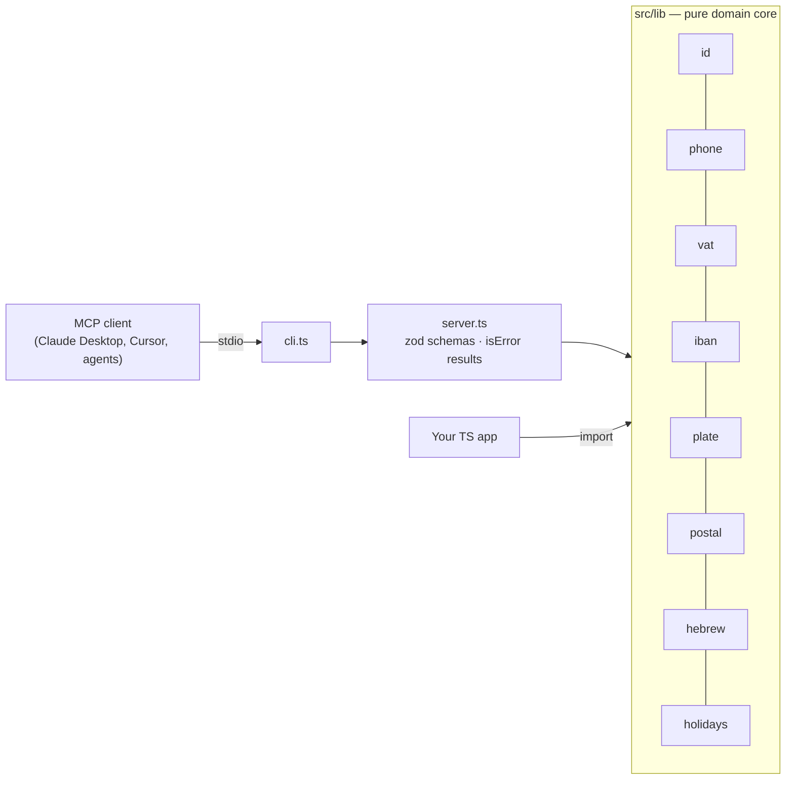

<div align="center">


[](https://github.com/Shtibel1/hebrew-il-mcp/actions/workflows/ci.yml)
[](package.json)
[](LICENSE)

[](https://modelcontextprotocol.io)

**Deterministic Israeli & Hebrew tools for AI agents — ת״ז, IBAN, מע״מ, מיקוד, bank days, Hebrew dates, gematria.**

</div>

<p align="center"><a href="#quick-start">Quick start</a> · <a href="#tools">Tools</a> · <a href="#architecture">Architecture</a> · <a href="#roadmap">Roadmap</a></p>


A [Model Context Protocol](https://modelcontextprotocol.io) server that gives AI agents reliable, deterministic tools for Israeli and Hebrew data — the things LLMs routinely get wrong when they try to do them "in their head":

## Tools

| Tool | What it does |
| --- | --- |
| `validate_israeli_id` | Validates Teudat Zehut / ח.פ / amuta / Osek Murshe numbers with the official check digit and detects the entity type from the registry prefix (51 company, 58 amuta, 55 partnership, …). |
| `normalize_israeli_phone` | Parses `050-1234567`, `+972 (0)54 765 4321`, `00972-3-…`, `1-800-…` into E.164 plus a national display format and line type (mobile / landline / VoIP / toll-free). |
| `calculate_israeli_vat` | Adds or splits מע"מ using the rate **in force on the transaction date** (17% → 18% on 2025‑01‑01, with history back to 2012), rounded to agorot. |
| `israeli_iban` | Validates an Israeli IBAN (ISO 7064 MOD 97-10), splits it into bank / branch / account and names the bank, or builds the IBAN from the domestic details printed on a cheque. |
| `normalize_israeli_plate` | Validates and formats Israeli vehicle licence plates, both the 7-digit `NN-NNN-NN` and the 8-digit `NNN-NN-NNN` formats. |
| `normalize_israeli_postal_code` | Validates a 7-digit Israeli postal code (מיקוד) and formats it as `XX-XXX-XX`. |
| `lookup_israeli_city` | Resolves Hebrew/English city names (aliases, niqqud-stripped) against a curated table of ~70 major localities with representative postal prefixes. |
| `israeli_city_from_postal` | Maps a 7-digit mikud to the best-matching curated locality via longest-prefix match (approximation — not a full Israel Post dump). |
| `israeli_business_day` | Checks whether a Gregorian date is an Israeli bank/clearing business day (Shabbat + full-closure Jewish holidays + Independence Day with civil postponement rules). Friday is still a business day. |
| `next_israeli_business_day` | Returns the first Israeli bank business day strictly after a given date. |
| `israeli_holidays` | Lists Israeli bank full-closure holidays (excl. weekly Shabbat) in a Gregorian year. |
| `israeli_vat_rate` | Returns the standard VAT rate for a given date. |
| `hebrew_date` | Converts a Gregorian date to the Hebrew calendar, including the traditional form (`כ״א בחשוון תשפ״ז`). |
| `hebrew_numeral` | Writes numbers as Hebrew numerals with correct ט״ו / ט״ז handling and gershayim. |
| `hebrew_text_tools` | Strips niqqud and cantillation marks and computes standard gematria. |

Every tool returns both human-readable text and `structuredContent`, and invalid input produces an MCP `isError` result instead of crashing the session.

## Why

Agents that handle Israeli invoices, CRM leads or bookkeeping keep tripping over the same things: an ID number that "looks fine" but fails the checksum, phone numbers stored in five formats, VAT computed at last year's rate, Hebrew dates hallucinated. These are pure, well-defined functions — so they belong in a tool, not in a prompt.

## Quick start

### Claude Desktop / Cursor / any MCP client

```json
{
  "mcpServers": {
    "hebrew-il": {
      "command": "npx",
      "args": ["-y", "github:Shtibel1/hebrew-il-mcp"]
    }
  }
}
```

Or from a local clone:

```bash
npm install && npm run build
node dist/cli.js   # speaks MCP over stdio
```

### As a library

```ts
import { validateIsraeliId, calculateVat, toHebrewDate, buildIsraeliIban, israeliBusinessDay, normalizeIsraeliPostalCode, lookupIsraeliCity } from "hebrew-il-mcp";

validateIsraeliId("515555555", "corporate"); // { valid, normalized, kind: "company", ... }
calculateVat(1180, true, "2026-03-01");      // { rate: 0.18, net: 1000, vat: 180, gross: 1180 }
toHebrewDate("2026-11-01").formatted;        // "כ״א בחשוון תשפ״ז"
buildIsraeliIban(10, 800, 99999999);         // "IL620108000000099999999"
israeliBusinessDay("2026-04-22").businessDay; // false — Independence Day
normalizeIsraeliPostalCode("12-345-67");     // { valid: true, formatted: "12-345-67", ... }
lookupIsraeliCity("Hadera");                 // { found: true, he: "חדרה", ... }
```

## Architecture



### Layout

```
src/
  lib/        pure, dependency-free domain functions (id, phone, vat, iban, plate, postal, hebrew, holidays)
  server.ts   MCP wiring: zod input schemas + uniform JSON / isError results
  cli.ts      stdio transport entry point
test/
  lib.test.ts     unit tests for each domain module
  server.test.ts  end-to-end tests through a real MCP client (in-memory transport)
```

- **Pure core, thin adapter.** All logic lives in `src/lib` with no MCP dependency, so it is reusable as a plain TypeScript library and trivially testable.
- **Date-aware VAT.** Rates are a dated table, not a constant, so historical invoices are computed correctly.
- **Hebrew calendar via ICU.** Conversion uses `Intl.DateTimeFormat` with `ca-hebrew` (no hand-rolled calendar math); only the letter-numeral formatting is custom.
- **Curated postal / city table.** ~70 major localities with prefix ranges — honest approximation, not a national Israel Post dump.

## Development

```bash
npm test          # vitest
npm run typecheck
npm run build
```

## Roadmap

- [ ] Publish to npm so `npx hebrew-il-mcp` works without the GitHub shorthand
- [x] Israeli bank-holiday / business-day calendar tool
- [x] Postal code and city-name normalization
- [ ] Hosted (Streamable HTTP) transport option

## Contributing

Issues and PRs are welcome. Every tool should stay a pure function in `src/lib` with unit tests, plus an end-to-end case in `test/server.test.ts`.

## License

[MIT](LICENSE) © Nadav Shtibel
